# TD Velo per Windows e Mac

**Toglie nomi, codici fiscali, IBAN e gli altri dati personali dai documenti prima di darli a un'intelligenza artificiale, e li rimette al loro posto nella risposta.** Tutto sul computer: nessun server, nessun cloud, nessun documento in rete.

[**Scarica l'ultima versione**](../../releases/latest) · [Pagina del programma](https://tastieredigitali.tech/software/pseudonimizzazione-dei-dati/) · Windows 10 e 11 a 64 bit · Mac con processore Apple · 7 giorni di prova

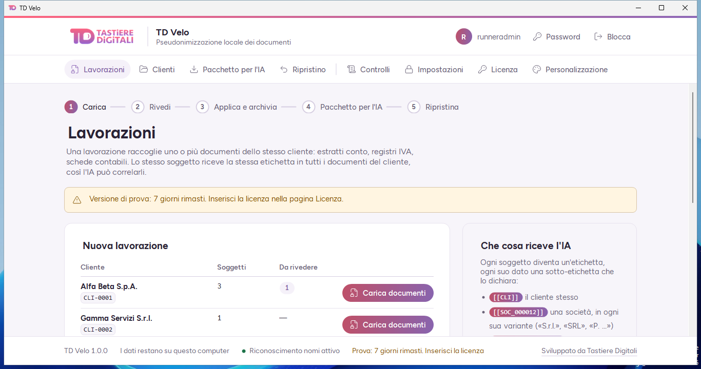

## A cosa serve

Uno studio che vuole farsi aiutare da un'IA su un contratto, un estratto conto o una pratica non può incollarci dentro i dati dei clienti. TD Velo risolve il problema sul computer dello studio:

1. legge il documento e riconosce i dati personali;
2. li sostituisce con etichette neutre, come `[[PF_000001]]` o `[[SOC_000003]]`;
3. ti fa controllare ogni sostituzione prima di confermare;
4. prepara il pacchetto da dare all'IA, senza dati reali;
5. quando l'IA risponde, rimette i dati veri nell'elaborato.

La stessa persona o società riceve sempre la stessa etichetta in tutti i documenti dello stesso cliente, così l'IA può ragionare sui collegamenti senza sapere di chi si parla.

## Come si usa

### 1. Carica i documenti

Scegli il cliente e trascina i file: testo, Word, Excel, PDF, anche scansionati. Ogni gruppo di documenti è una **lavorazione**.

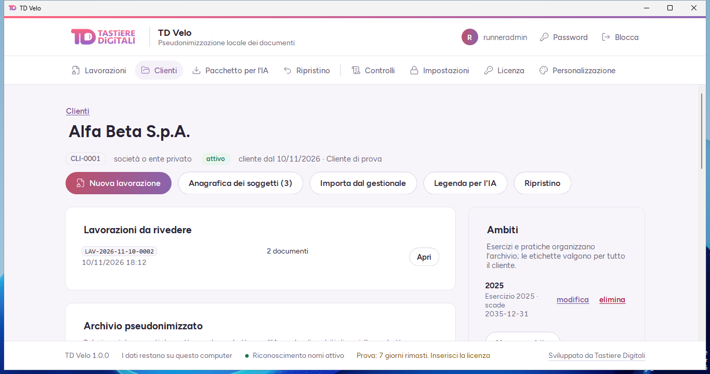

### 2. Rivedi le sostituzioni

Il programma propone, tu decidi. Per ogni nome trovato scegli se è un soggetto già noto, uno nuovo o non è un dato personale. Lo stesso vale per identificativi, date e frasi sensibili (salute, dati giudiziari e simili).

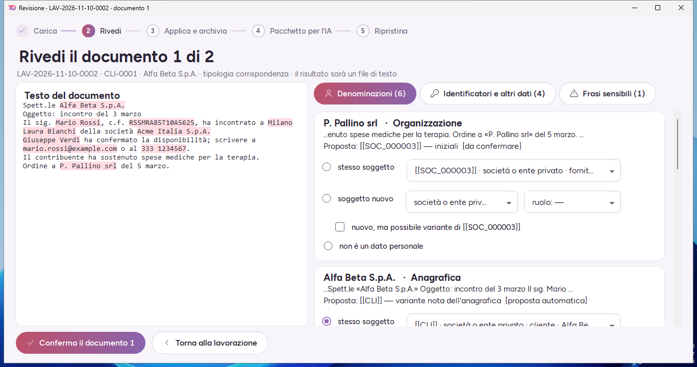

### 3. Applica e archivia

Alla conferma il programma riscrive i documenti e fa un controllo finale: se nel risultato resta un identificativo o un nome dell'anagrafica, lo dice e non archivia.

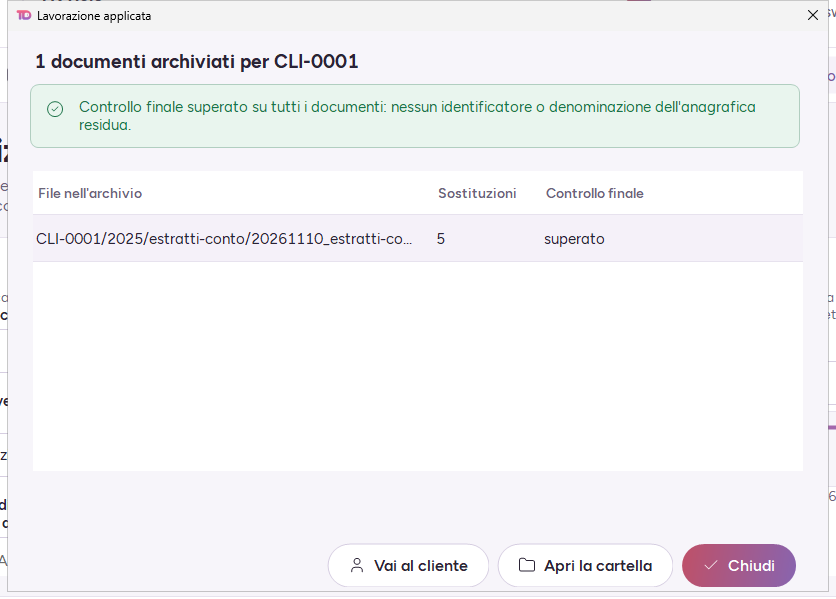

### 4. Prepara il pacchetto per l'IA

Scegli i documenti pseudonimizzati e salva un file zip con i documenti e la descrizione delle etichette. È quello che carichi nell'IA.

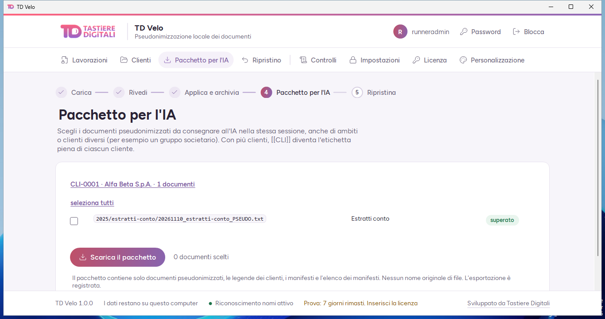

### 5. Ripristina la risposta

Incolla il testo che l'IA ti ha restituito, o scegli il file: le etichette tornano a essere nomi e numeri veri. Il ripristino resta sul computer.

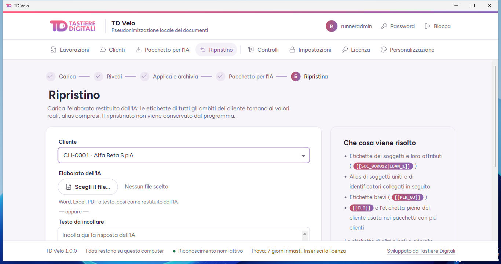

## Cosa riconosce

| Tipo | Esempi |
| --- | --- |
| Persone e società | Nomi, cognomi, denominazioni, con un modello di intelligenza artificiale italiano che gira sul computer, senza rete |
| Identificativi | Codice fiscale, partita IVA, IBAN (con controllo delle cifre), carte, targhe, posizioni INPS |
| Recapiti | E-mail, telefoni, indirizzi, siti web e indirizzi di rete |
| Immobili, atti e documenti | Dati catastali (foglio, particella, subalterno), numeri di ruolo e di protocollo, numeri di carta d'identità, passaporto e patente |
| Movimenti bancari | Ordinanti e beneficiari negli estratti conto, intestatari dei conti nelle schede contabili |
| Date | Le date presenti nei documenti |
| Categorie particolari | Frasi su salute, dati giudiziari e simili (artt. 9 e 10 GDPR), che vengono oscurate |

Formati: testo, Word, Excel, PDF con testo e PDF scansionati. I PDF scansionati si leggono con il riconoscimento del testo del sistema, sul computer: su Windows serve la lingua italiana dell'OCR (Impostazioni → Lingua), sul Mac non serve nulla.

## Il modello di intelligenza artificiale

Per riconoscere nomi di persone, società e luoghi TD Velo usa un modello linguistico italiano che sta **dentro il programma** e lavora sul tuo computer. Non chiama servizi esterni e funziona senza Internet.

| | |
| --- | --- |
| Modello | [`osiria/bert-italian-cased-ner`](https://huggingface.co/osiria/bert-italian-cased-ner), una rete BERT addestrata sull'italiano, licenza Apache 2.0 |
| Formato | ONNX a 8 bit, eseguito con ONNX Runtime sul processore: non serve una scheda grafica |
| Dimensione | Circa 110 MB, già compresi nell'MSI e nel DMG: non c'è niente da scaricare a parte |
| Memoria | Circa 500 MB di RAM per tutto il programma mentre analizza un documento (misurati circa 400 MB per il solo motore) |
| Requisiti del computer | 4 GB di RAM, 1 GB libero su disco per programma e modello, più lo spazio per l'archivio |
| Che cosa non fa | Non impara dai tuoi documenti e non invia nulla: è un file fisso, uguale per tutti |

Codici fiscali, partite IVA, IBAN, e-mail, telefoni e gli altri identificativi non passano dal modello: li trovano regole precise, con il controllo delle cifre dove esiste. Se il modello non si carica, il programma lo dice in basso nella finestra e continua a lavorare con queste regole e con l'anagrafica del cliente.

## Impara dalle tue revisioni

Il file del modello resta quello, ma il programma intorno impara da quello che decidi in revisione, e lo fa sul tuo computer:

- **Quello che non è un dato personale.** Quando su una parola scegli «non è un dato personale», TD Velo se lo ricorda per tutti i clienti: la volta dopo te la propone già così. La vedi comunque, e se in quel documento è un nome ti basta cambiare la scelta perché il programma si corregga.
- **Le parole su cui è incerto.** Se il modello non è sicuro che una parola sia un nome, te lo chiede (poche domande per documento). La risposta viene ricordata e la domanda non torna.
- **I nomi che gli sono sfuggiti.** In revisione puoi scrivere, o selezionare nel testo, un nome che non era evidenziato: il documento si rianalizza e, alla conferma, il nome entra nell'anagrafica di quel cliente. Dalla lavorazione successiva lo riconosce da solo.
- **I nomi veri restano del cliente.** Persone e società confermate finiscono nell'anagrafica cifrata del singolo cliente e non passano mai da un cliente all'altro.

L'elenco di ciò che ha imparato è in **Impostazioni → Imparato dalle revisioni**, con il comando per fargli dimenticare una parola.

## Dove stanno i dati

- **Sul computer, e basta.** Documenti, anagrafiche e chiavi non escono. Non c'è telemetria.
- **Cifrati.** La corrispondenza fra etichette e dati reali è cifrata con AES-256; ogni cliente ha la sua chiave, protetta dalla password del programma.
- **Password e chiave di recupero.** Al primo avvio scegli la password e ricevi una chiave di recupero da stampare. Chi le perde entrambe perde i dati: non esiste una porta di servizio, nemmeno per noi.
- **Registro delle operazioni.** Ogni operazione è annotata in un registro a catena, e la pagina Controlli verifica che nessuno lo abbia alterato.
- **Internet facoltativo.** L'unico collegamento è la lettura, una volta al giorno, dello stato pubblico delle licenze. Senza rete il programma funziona allo stesso modo.

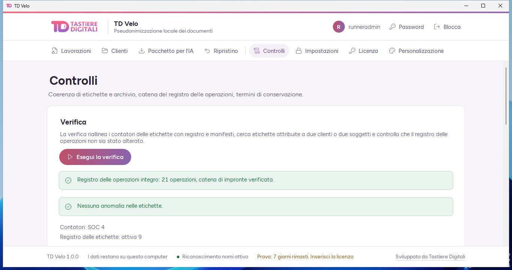

## Installazione su Windows

1. Scarica `TD-Velo-<versione>.msi` dalla pagina [Releases](../../releases/latest).
2. Aprilo: il pacchetto è **firmato digitalmente** da Tastiere Digitali e Windows mostra il nostro nome come editore verificato.
3. Al primo avvio scegli la password e conserva la chiave di recupero.

Per controllare che il file sia quello pubblicato, confronta la sua impronta con il file `.sha256` allegato al rilascio:

```powershell
Get-FileHash -Algorithm SHA256 .\TD-Velo-1.1.2.msi
```

Gli aggiornamenti si installano sopra la versione precedente; i dati restano dove sono, in `%LOCALAPPDATA%\TD Velo`.

## Installazione su Mac

Serve un Mac con processore Apple (M1 o successivo) e macOS 12 o più recente.

1. Scarica `TD-Velo-<versione>-mac.dmg` dalla pagina [Releases](../../releases/latest).
2. Aprilo e trascina **TD Velo** nella cartella **Applicazioni**.
3. Aprilo dalle Applicazioni. Se macOS dice che non può verificare lo sviluppatore: **Impostazioni di Sistema → Privacy e sicurezza**, in fondo alla pagina **Apri comunque** accanto a TD Velo. Si fa una volta sola.
4. Al primo avvio scegli la password e conserva la chiave di recupero.

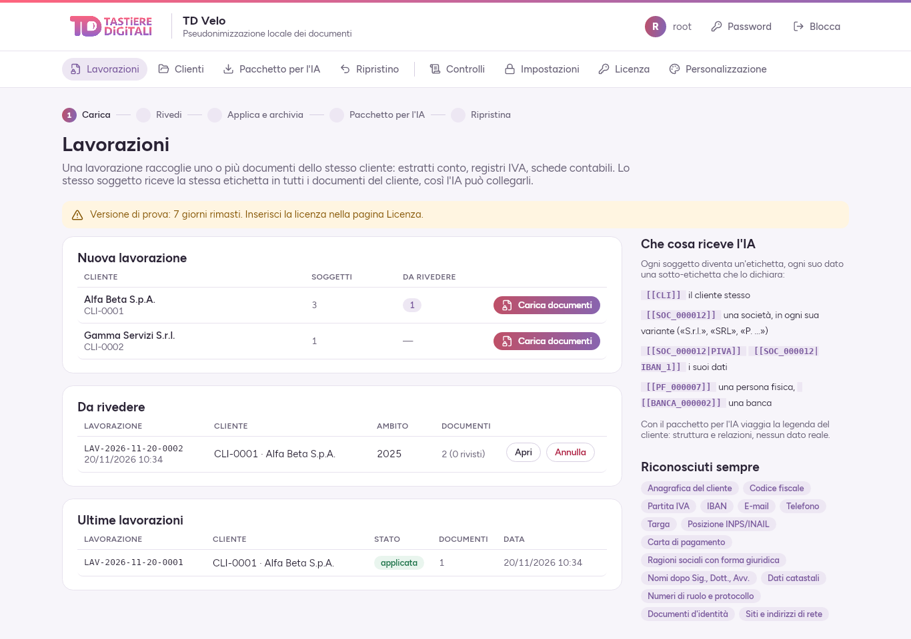

È un programma nativo, con le stesse pagine e le stesse funzioni della versione Windows. Se non dovesse aprirsi, il file `~/Library/Application Support/Tastiere Digitali/TD Velo/avvio.log` dice dove si è fermato (contiene solo i passi dell'avvio, nessun dato): mandacelo. I dati stanno in `~/Library/Application Support/TD Velo`, l'archivio dei documenti pseudonimizzati in `Documenti/TD Velo/Archivio`.

Per controllare il file scaricato:

```bash
shasum -a 256 TD-Velo-1.1.2-mac.dmg
```

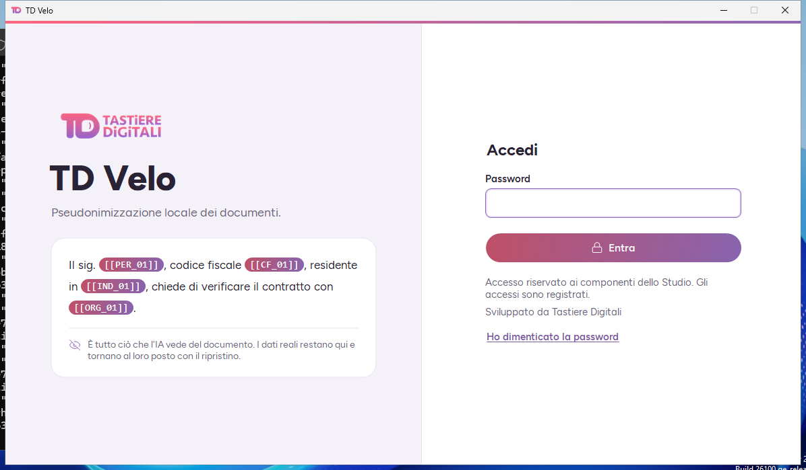

## Prova e licenza

Il programma funziona per **7 giorni** senza licenza. Poi archivio, legende e ripristino restano consultabili, ma per nuove lavorazioni e nuovi pacchetti serve una licenza.

La licenza è legata al computer, Windows o Mac. Dalla pagina **Licenza** copi il codice d'installazione, lo mandi a [Tastiere Digitali](https://tastieredigitali.it) e ricevi una riga che inizia con `TDVL1.` da incollare nella stessa pagina.

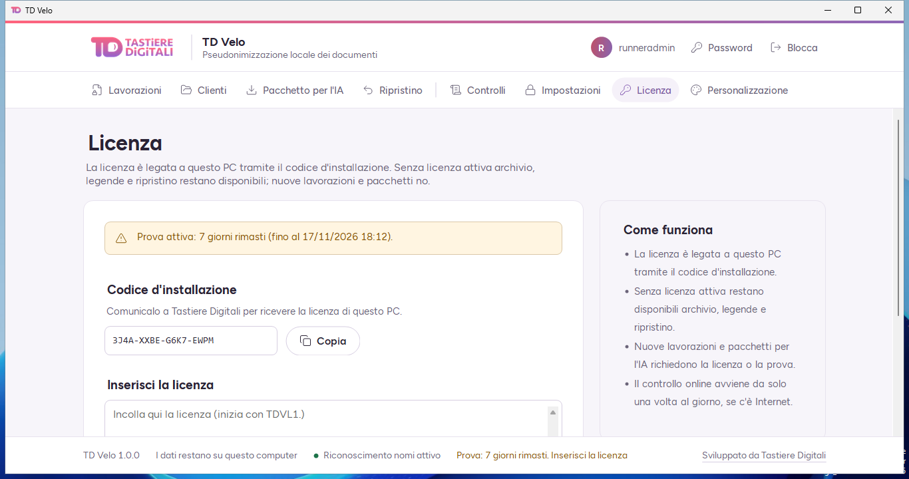

## Personalizzazione

Nome del programma, testi, colori e logo si cambiano dalla pagina **Personalizzazione**, anche per la finestra di accesso. C'è il tema chiaro e quello scuro.

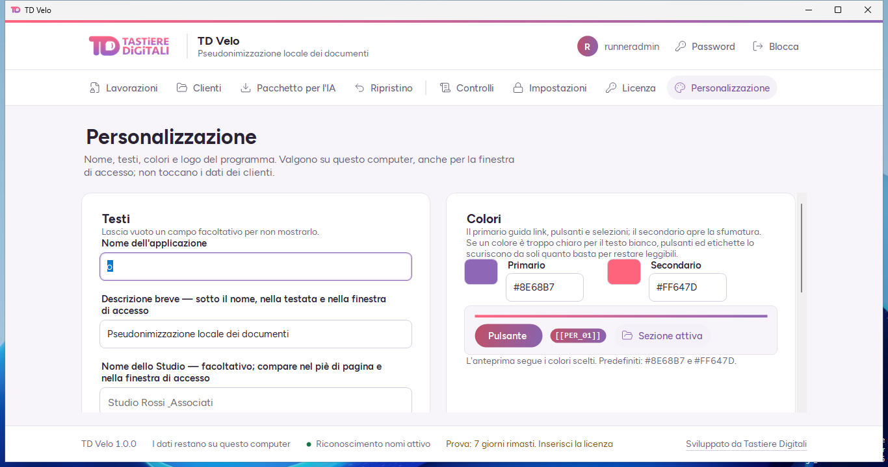


## Domande frequenti

**Serve Internet?** No. Serve solo per scaricare il programma e, se c'è, per aggiornare lo stato della licenza.

**L'IA vede i dati dei miei clienti?** Vede le etichette. La tabella che le collega ai dati reali resta cifrata sul computer.

**Usa un'intelligenza artificiale per riconoscere i nomi?** Sì, un modello italiano che sta dentro il programma e gira sul tuo computer. Non manda niente a nessuno.

**Il riconoscimento è infallibile?** No, ed è il motivo per cui ogni documento passa dalla tua revisione e da un controllo finale automatico prima di essere archiviato. Più lo usi, meno deve chiederti: ricorda le tue risposte.

**Posso usarlo su più computer?** Sì, con una licenza per ogni computer, Windows o Mac. Gli archivi non sono condivisi: ogni installazione ha i suoi.

**Ho dimenticato la password.** Nella finestra di accesso: **Ho dimenticato la password**, poi la chiave di recupero.

## Diritti

© Tastiere Digitali S.r.l.s. Tutti i diritti riservati. Non è consentito copiare, rivendere o distribuire il programma,
né aggirare o togliere il controllo della licenza. Le componenti di terzi e le loro licenze sono in
[`TERZE-PARTI.txt`](TERZE-PARTI.txt).

Tastiere Digitali S.r.l.s. — Via Latina 276, 00179 Roma — P.IVA 17462291000 — [tastieredigitali.it](https://tastieredigitali.it) — [TD Velo su tastieredigitali.tech](https://tastieredigitali.tech/software/pseudonimizzazione-dei-dati/)
