# TD Velo per Windows

**Toglie nomi, codici fiscali, IBAN e gli altri dati personali dai documenti prima di darli a un'intelligenza artificiale, e li rimette al loro posto nella risposta.** Tutto sul PC: nessun server, nessun cloud, nessun documento in rete.

[**Scarica l'ultima versione**](../../releases/latest) · Windows 10 e 11 a 64 bit · 7 giorni di prova

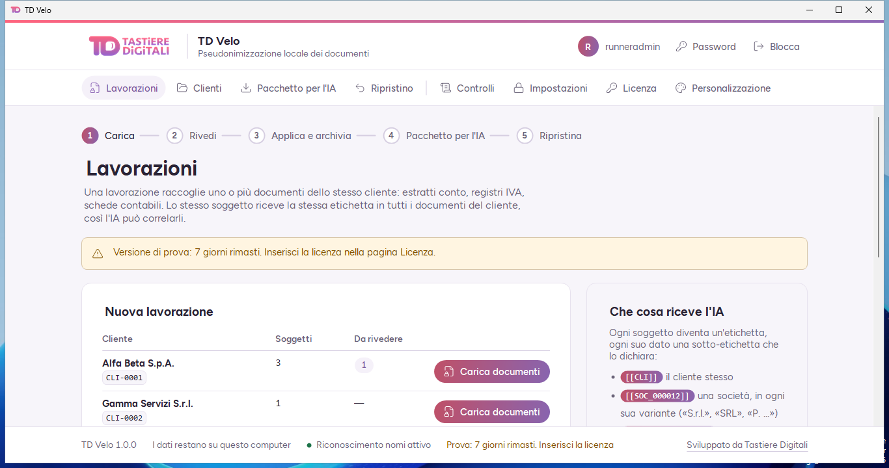

## A cosa serve

Uno studio che vuole farsi aiutare da un'IA su un contratto, un estratto conto o una pratica non può incollarci dentro i dati dei clienti. TD Velo risolve il problema sul PC dello studio:

1. legge il documento e riconosce i dati personali;
2. li sostituisce con etichette neutre, come `[[PF_000001]]` o `[[SOC_000003]]`;
3. ti fa controllare ogni sostituzione prima di confermare;
4. prepara il pacchetto da dare all'IA, senza dati reali;
5. quando l'IA risponde, rimette i dati veri nell'elaborato.

La stessa persona o società riceve sempre la stessa etichetta in tutti i documenti dello stesso cliente, così l'IA può ragionare sui collegamenti senza sapere di chi si parla.

## Come si usa

### 1. Carica i documenti

Scegli il cliente e trascina i file: testo, Word, Excel, PDF, anche scansionati. Ogni gruppo di documenti è una **lavorazione**.

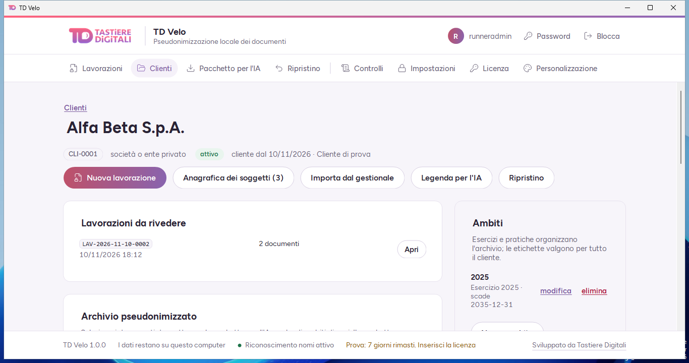

### 2. Rivedi le sostituzioni

Il programma propone, tu decidi. Per ogni nome trovato scegli se è un soggetto già noto, uno nuovo o non è un dato personale. Lo stesso vale per identificativi, date e frasi sensibili (salute, dati giudiziari e simili).

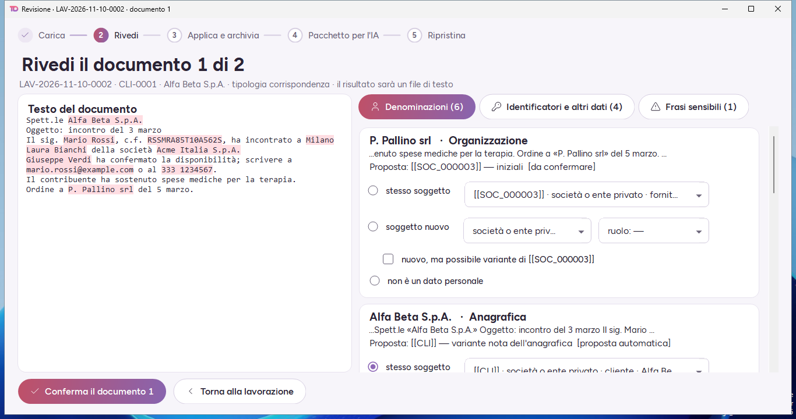

### 3. Applica e archivia

Alla conferma il programma riscrive i documenti e fa un controllo finale: se nel risultato resta un identificativo o un nome dell'anagrafica, lo dice e non archivia.

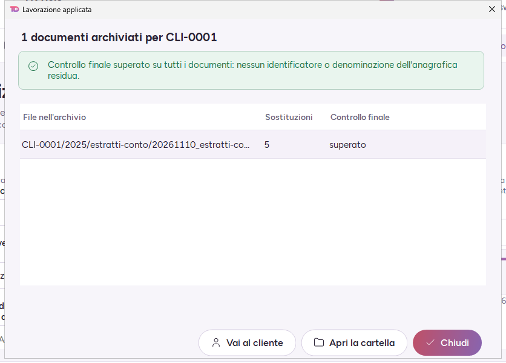

### 4. Prepara il pacchetto per l'IA

Scegli i documenti pseudonimizzati e salva un file zip con i documenti e la descrizione delle etichette. È quello che carichi nell'IA.

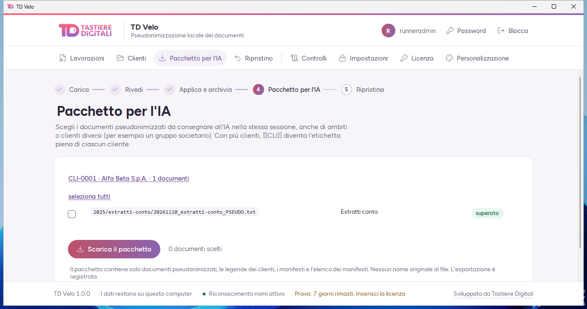

### 5. Ripristina la risposta

Incolla il testo che l'IA ti ha restituito, o scegli il file: le etichette tornano a essere nomi e numeri veri. Il ripristino resta sul PC.

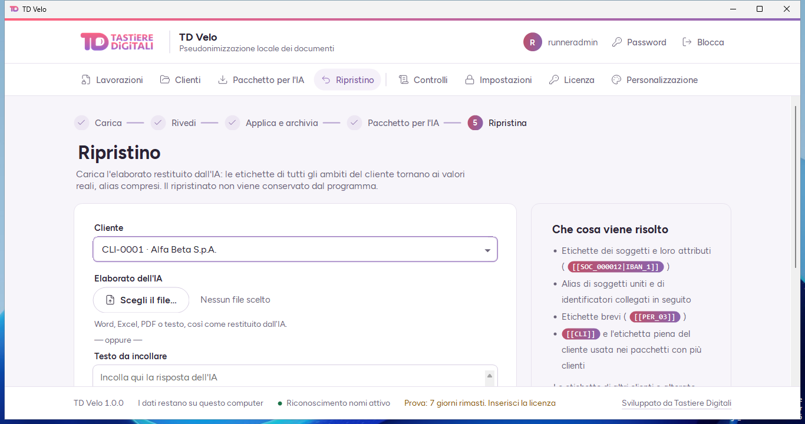

## Cosa riconosce

| Tipo | Esempi |
| --- | --- |
| Persone e società | Nomi, cognomi, denominazioni, con un modello linguistico italiano che gira sul PC |
| Identificativi | Codice fiscale, partita IVA, IBAN (con controllo delle cifre), carte, targhe, posizioni INPS |
| Recapiti | E-mail, telefoni, indirizzi |
| Date | Le date presenti nei documenti |
| Categorie particolari | Frasi su salute, dati giudiziari e simili (artt. 9 e 10 GDPR), che vengono oscurate |

Formati: testo, Word, Excel, PDF con testo e PDF scansionati. Per i PDF scansionati serve la lingua italiana dell'OCR di Windows (Impostazioni → Lingua).

## Dove stanno i dati

- **Sul PC, e basta.** Documenti, anagrafiche e chiavi non escono. Non c'è telemetria.
- **Cifrati.** La corrispondenza fra etichette e dati reali è cifrata con AES-256; ogni cliente ha la sua chiave, protetta dalla password del programma.
- **Password e chiave di recupero.** Al primo avvio scegli la password e ricevi una chiave di recupero da stampare. Chi le perde entrambe perde i dati: non esiste una porta di servizio, nemmeno per noi.
- **Registro delle operazioni.** Ogni operazione è annotata in un registro a catena, e la pagina Controlli verifica che nessuno lo abbia alterato.
- **Internet facoltativo.** L'unico collegamento è la lettura, una volta al giorno, dello stato pubblico delle licenze. Senza rete il programma funziona allo stesso modo.

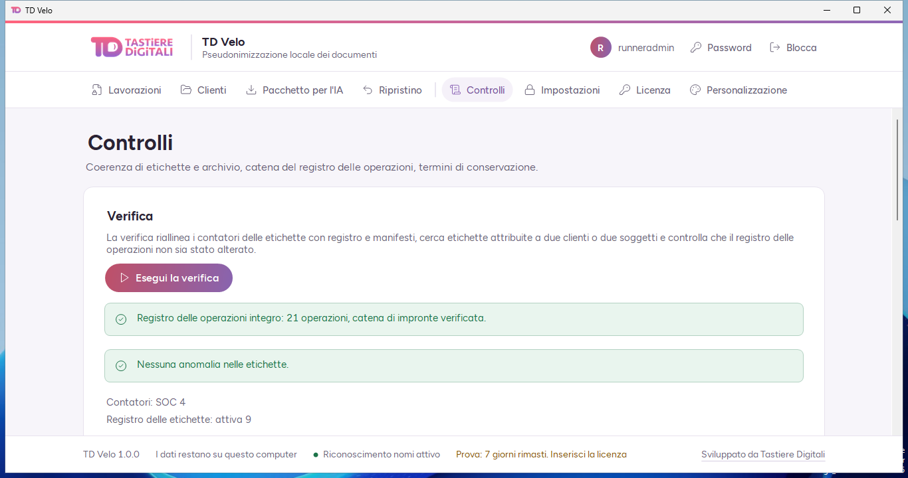

## Installazione

1. Scarica `TD-Velo-<versione>.msi` dalla pagina [Releases](../../releases/latest).
2. Aprilo. Windows può mostrare l'avviso «app non riconosciuta» perché il pacchetto non è ancora firmato: **Ulteriori informazioni** → **Esegui comunque**.
3. Al primo avvio scegli la password e conserva la chiave di recupero.

Per controllare che il file sia quello pubblicato, confronta la sua impronta con il file `.sha256` allegato al rilascio:

```powershell
Get-FileHash -Algorithm SHA256 .\TD-Velo-1.0.0.msi
```

Gli aggiornamenti si installano sopra la versione precedente; i dati restano dove sono, in `%LOCALAPPDATA%\TD Velo`.

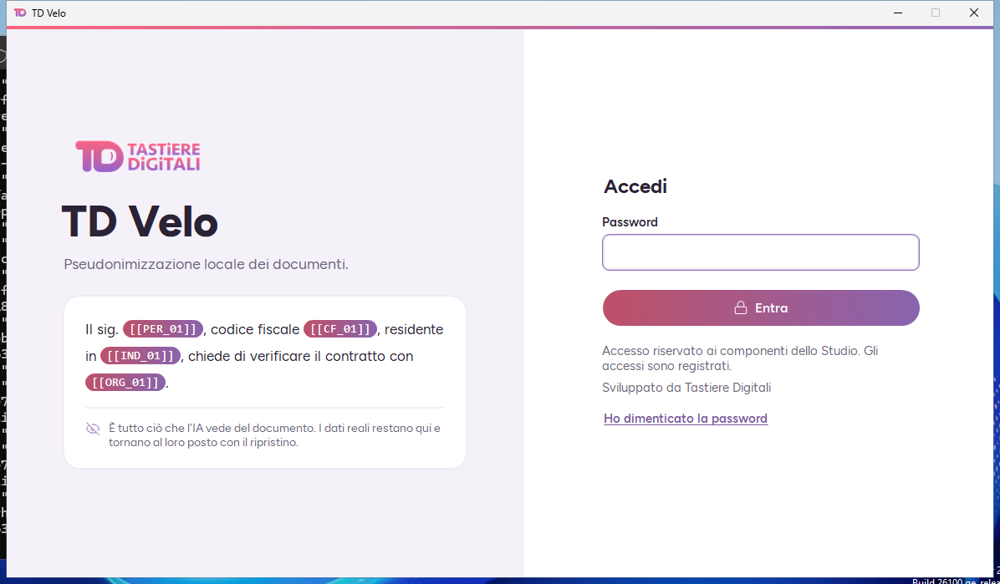

## Prova e licenza

Il programma funziona per **7 giorni** senza licenza. Poi archivio, legende e ripristino restano consultabili, ma per nuove lavorazioni e nuovi pacchetti serve una licenza.

La licenza è legata al PC. Dalla pagina **Licenza** copi il codice d'installazione, lo mandi a [Tastiere Digitali](https://tastieredigitali.it) e ricevi una riga che inizia con `TDVL1.` da incollare nella stessa pagina.

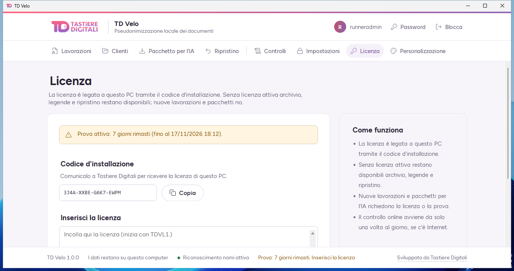

## Personalizzazione

Nome del programma, testi, colori e logo si cambiano dalla pagina **Personalizzazione**, anche per la finestra di accesso. C'è il tema chiaro e quello scuro.

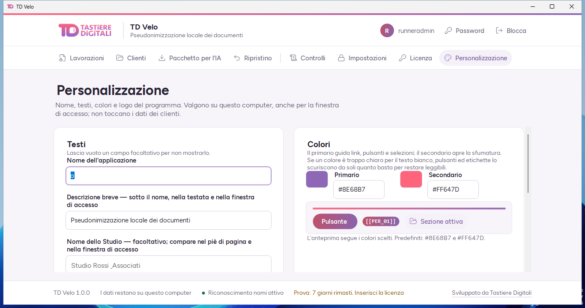

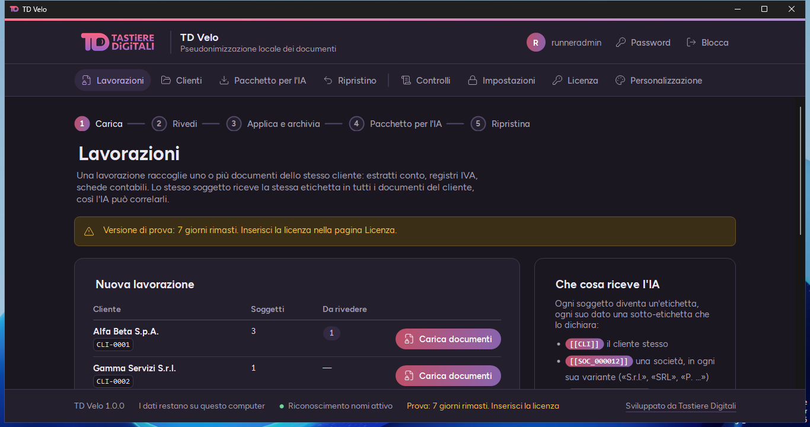

## Domande frequenti

**Serve Internet?** No. Serve solo per scaricare il programma e, se c'è, per aggiornare lo stato della licenza.

**L'IA vede i dati dei miei clienti?** Vede le etichette. La tabella che le collega ai dati reali resta cifrata sul PC.

**Il riconoscimento è infallibile?** No, ed è il motivo per cui ogni documento passa dalla tua revisione e da un controllo finale automatico prima di essere archiviato.

**Posso usarlo su più PC?** Sì, con una licenza per ogni PC. Gli archivi non sono condivisi: ogni installazione ha i suoi.

**Ho dimenticato la password.** Nella finestra di accesso: **Ho dimenticato la password**, poi la chiave di recupero.

## Diritti

© Tastiere Digitali S.r.l.s. Tutti i diritti riservati. Non è consentito copiare, rivendere o distribuire il programma,
né aggirare o togliere il controllo della licenza. Le componenti di terzi e le loro licenze sono in
[`TERZE-PARTI.txt`](TERZE-PARTI.txt).

Tastiere Digitali S.r.l.s. — Via Latina 276, 00179 Roma — P.IVA 17462291000 — [tastieredigitali.it](https://tastieredigitali.it)
